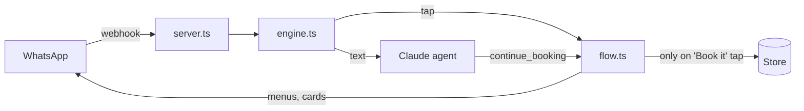

<div align="center">

# whatsapp-booking-agent

**Your customers book on WhatsApp. Claude answers in seconds. Nobody gets booked by mistake.**


[Try it in 1 minute](#try-it-in-1-minute) · [See a chat](#what-your-customers-see) · [Give it to your AI](#give-it-to-your-ai)

</div>

---

## Your customers are already there

- **3 billion people** use WhatsApp every month. ([Meta, Q1 2025](https://mezha.ua/en/news/whatsapp-3-milyarda-mau-301590/))
- **200 million+** use the WhatsApp Business app every month. ([Statista](https://www.statista.com/statistics/1538342/whatsapp-business-mau-worldwide))

They already send messages like *"do you have time on Saturday?"*. If nobody answers at 11 pm, they book with whoever does.

This kit answers every one of them, books the slot, and never double books.

## What your customers see

```
Elif:  haircut with mert tuesday at noon?

Nova:  Mert has 12:00 free on Tuesday.
       ┌──────────────────────────────┐
       │ Haircut                      │
       │ Tuesday 13 October, 12:00    │
       │ with Mert                    │
       │ ₺600                         │
       │                              │
       │ Shall I book it?             │
       │   [ Book it ]   [ Change ]   │
       └──────────────────────────────┘

Elif:  (taps Book it)

Nova:  Booked ✅
```

No app to download and no form to fill in. The customer types the way they talk, then taps.

## Why it's safe

**The AI cannot book anything.** It has no tool for that.

| Who | What they can do |
|---|---|
| Claude | Read the message, show menus, show the confirmation card |
| The customer | Tap **Book it**. Only this saves a booking |
| The database | Refuse a second booking for the same slot, even if two people tap at the same second |

A confused model can show the wrong menu. It can never create or cancel an appointment.

## Who it's for

| You run | It handles |
|---|---|
| A salon or barber shop | Haircuts, colour, nails, with each person's own hours |
| A clinic or studio | Sessions with a fixed length and a booking window |
| A side project for local businesses | A ready engine you can sell or set up for clients |

## Try it in 1 minute

You don't need a WhatsApp account. The terminal shows menus as numbered options; type a number to tap.

```bash
git clone https://github.com/m-fyi/whatsapp-booking-agent
cd whatsapp-booking-agent
npm install
npm run chat
```

No API key? It still runs as a menu bot, so you can try the whole booking flow for free. Add `ANTHROPIC_API_KEY` to `.env` (copy `.env.example`) to chat in plain language.

## Give it to your AI

Already have an app? Paste [`prompts/add-to-my-app.md`](prompts/add-to-my-app.md) into Claude Code, Cursor or any coding agent. It plans the integration with you first, then adds the booking assistant to your project and keeps the safety rule.

Working on this repo with an agent? It reads [`AGENTS.md`](AGENTS.md).

## What's inside

- **Plain language in, menus out.** Claude reads the message. WhatsApp lists and buttons do the rest.
- **Real free times only.** Opening hours, each person's hours, service length, existing bookings, how soon and how far ahead people can book.
- **No double booking.** Checked in code and enforced by the database.
- **No silent failures.** Errors are reported, and the customer always gets a reply.
- **Hand off to a person.** The bot steps back when a customer asks for a human.
- **English and Turkish** built in.
- **Cheap to run.** Taps never call the AI, and the system prompt is cached.

---

<details>
<summary><b>Connect WhatsApp</b></summary>

1. Create an app at [developers.facebook.com](https://developers.facebook.com), add **WhatsApp**, and note the **phone number ID** and **access token**.
2. Fill in `.env` (see `.env.example`).
3. Run `npm start`. It listens on `PORT` (3000).
4. Put it behind HTTPS (any host or tunnel). Set the webhook URL to `https://your-host/webhook` with your `WHATSAPP_VERIFY_TOKEN`, and subscribe to `messages`.
5. Send a message to your WhatsApp number.

</details>

<details>
<summary><b>Set up your business</b></summary>

Everything lives in one JSON file. See [`examples/salon.json`](examples/salon.json).

```jsonc
{
  "name": "Studio Nova",
  "language": "en",                 // "en" or "tr"
  "timezone": "Europe/Istanbul",
  "currency": "TRY",
  "minLeadMinutes": 60,             // no bookings sooner than this
  "maxLeadDays": 14,                // how far ahead people can book
  "hours": { "mon": ["09:00", "19:00"], "sun": null },
  "services": [{ "id": "haircut", "name": "Haircut", "minutes": 45, "price": 600 }],
  "staff": [{ "id": "mert", "name": "Mert", "services": ["haircut"] }],
  "faq": [{ "q": "Where are you?", "a": "Moda Caddesi 12, Kadıköy." }]
}
```

The file is checked on start, with a clear message for each mistake.

</details>

<details>
<summary><b>Storage</b></summary>

| Store | Use it for | Setting |
|---|---|---|
| Memory | Trying it, tests | `STORE=memory` (default) |
| Supabase | Production | `STORE=supabase`, then run [`supabase/schema.sql`](supabase/schema.sql) |
| Your own | Prisma, Drizzle, anything | Implement `Store` in [`src/store/types.ts`](src/store/types.ts) (7 methods) |

</details>

<details>
<summary><b>How it works</b></summary>



- **Text** goes to Claude. Every tool it has either reads data or sends a menu.
- **Taps** never reach Claude. `flow.ts` reads the option id, like `slot:2026-10-13|12:00`.
- **`advance()`** picks the next step for both paths, so they always agree.
- **`book()`** is the only function that saves a booking. Only the `Book it` tap calls it, and it checks the slot again first.

Use the engine inside your own server:

```ts
import Anthropic from "@anthropic-ai/sdk";
import { createEngine, createMemoryStore, loadBusiness } from "./src/index.js";

const claude = new Anthropic();
const engine = createEngine({
  business: loadBusiness("examples/salon.json"),
  store: createMemoryStore(),
  agent: { create: (p) => claude.beta.messages.create(p), model: "claude-opus-5-5", effort: "low" },
  onHandoff: (convo, reason) => notifyMyTeam(convo.phone, reason),
});

const replies = await engine.handle({ messageId: "wamid.1", from: "905551112233", name: "Elif", type: "text", text: "hi" });
```

</details>

<details>
<summary><b>Tests</b></summary>

```bash
npm test
```

No API key needed. A scripted fake Claude checks the core rule: a confirmation card alone never creates a booking.

</details>

---

<div align="center">

**If this saves you a week, give it a ⭐ so others can find it.**

MIT · Built by [Melih İlkay Deniz](https://github.com/m-fyi)

</div>
