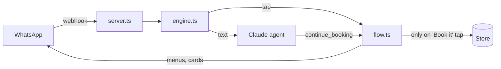

# whatsapp-booking-agent

A WhatsApp booking assistant for salons, clinics, barbers and studios, powered by Claude.

Customers write the way they talk: *"haircut with Mert tomorrow after 2?"*. Claude understands it and answers with native WhatsApp menus. The customer taps a time, then taps **Book it**.

**The AI never books anything by itself.** It has no tool that writes a booking. Only the customer's tap on the confirmation card does. So even a confused model can't create an appointment nobody asked for.

<!-- TODO: demo GIF of a real WhatsApp chat -->

```
you:   haircut with mert tuesday at noon?
Nova:  Mert has 12:00 free on Tuesday.
       ┌──────────────────────────────┐
       │ Haircut                      │
       │ Tuesday 13 October, 12:00    │
       │ with Mert                    │
       │ ₺600                         │
       │                              │
       │ Shall I book it?             │
       │  [ Book it ]   [ Change ]    │
       └──────────────────────────────┘
you:   (taps Book it)
Nova:  Booked ✅
```

## Try it in one minute

No WhatsApp account needed. The terminal chat shows menus as numbered options; type a number to tap one.

```bash
git clone https://github.com/m-fyi/whatsapp-booking-agent
cd whatsapp-booking-agent
npm install
cp .env.example .env      # add ANTHROPIC_API_KEY to chat with Claude
npm run chat
```

Without an API key it still runs as a menu-only bot, so you can click through the whole booking flow for free.

## What you get

- **Natural language in, tappable menus out.** Claude reads the message; WhatsApp list and button messages do the rest.
- **One booking tool, not ten.** Claude calls `continue_booking` with whatever the customer said. The engine sends the next missing step: staff, day, time or the confirmation card.
- **Real availability only.** Opening hours, each person's own hours, service length, existing bookings, a minimum lead time and a booking window. Claude never guesses a free time.
- **No double booking.** The memory store checks and writes in one step. The Supabase store has a Postgres exclusion constraint, so two servers racing for one slot can't both win. The loser is shown the times still free.
- **No silent failures.** API errors are logged through `onError` and the customer gets a reply. A model refusal or a stuck loop hands the chat to your team.
- **Hand off to a person.** Claude can pass a conversation to your team; the bot then stays quiet for that customer.
- **Webhook-safe.** Signature check, duplicate deliveries skipped, messages from one customer handled in order.
- **English and Turkish** menus included. Add a language in `src/i18n.ts`.
- **Prompt caching** on the system prompt, and refusal fallback on, through the Claude API.

## Give it to your AI

Already have an app? Paste [`prompts/add-to-my-app.md`](prompts/add-to-my-app.md) into Claude Code, Cursor or any coding agent. It tells the agent how to add this booking assistant to your project, wire it to your database and keep the safety rule intact.

Working on this repo with an agent? It reads [`AGENTS.md`](AGENTS.md) first.

## Connect WhatsApp

1. Create an app at [developers.facebook.com](https://developers.facebook.com), add the **WhatsApp** product and note your **phone number ID** and **access token**.
2. Fill in `.env` (see `.env.example`).
3. Start the server: `npm start`. It listens on `PORT` (3000).
4. Expose it over HTTPS (any tunnel or host), then set the webhook URL to `https://your-host/webhook` with your `WHATSAPP_VERIFY_TOKEN`, and subscribe to the `messages` field.
5. Message your WhatsApp number.

## Set up your business

Everything about the business lives in one JSON file. See [`examples/salon.json`](examples/salon.json):

```jsonc
{
  "name": "Studio Nova",
  "language": "en",                 // "en" or "tr"
  "timezone": "Europe/Istanbul",
  "currency": "TRY",
  "minLeadMinutes": 60,             // no bookings sooner than this
  "maxLeadDays": 14,                // booking window
  "hours": { "mon": ["09:00", "19:00"], "sun": null, ... },
  "services": [{ "id": "haircut", "name": "Haircut", "minutes": 45, "price": 600 }],
  "staff": [{ "id": "mert", "name": "Mert", "services": ["haircut"], "hours": { ... } }],
  "faq": [{ "q": "Where are you?", "a": "Moda Caddesi 12, Kadıköy." }]
}
```

The file is validated on start, with a clear error for each mistake.

## Storage

| Store | Use it for | Set |
|---|---|---|
| Memory | Trying it out, tests | `STORE=memory` (default) |
| Supabase | Production | `STORE=supabase`, run [`supabase/schema.sql`](supabase/schema.sql) |
| Your own | Prisma, Drizzle, anything | Implement the `Store` interface in [`src/store/types.ts`](src/store/types.ts) (7 methods) |

## How it works



- **Text** goes to Claude, which may call tools. Every tool either reads data or sends a menu.
- **Taps** never reach Claude. `flow.ts` reads the option id (`slot:2026-10-13|12:00`) and moves to the next step.
- **`advance()`** in `flow.ts` decides the next step for both paths, so they can't disagree.
- **`book()`** is the only function that writes a booking, and only a `confirm:yes` tap calls it. It checks the slot again first, because the card may be minutes old.

Use it as a library in your own server:

```ts
import Anthropic from "@anthropic-ai/sdk";
import { createEngine, createMemoryStore, loadBusiness } from "./src/index.js";

const claude = new Anthropic();
const engine = createEngine({
  business: loadBusiness("examples/salon.json"),
  store: createMemoryStore(),
  agent: { create: (p) => claude.beta.messages.create(p), model: "claude-opus-5-5", effort: "low" },
  onHandoff: (convo, reason) => notifyMyTeam(convo.phone, reason),
});

const replies = await engine.handle({ messageId: "wamid.1", from: "905551112233", name: "Elif", type: "text", text: "hi" });
```

## Tests

```bash
npm test
```

The tests run without an API key. A scripted fake Claude checks the agent's behaviour, including the core rule: a confirmation card alone never creates a booking.

## License

MIT. Built by [Melih İlkay Deniz](https://github.com/m-fyi).
